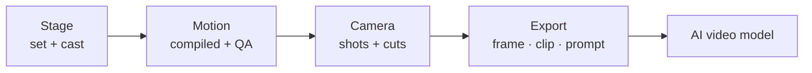

<p align="center">
  
</p>

<p align="center">
  <a href="README.md">English</a> ·
  <a href="README.ko.md">한국어</a> ·
  <a href="README.ja.md">日本語</a> ·
  <a href="README.zh-CN.md">简体中文</a> ·
  <a href="README.zh-TW.md">繁體中文</a> ·
  <a href="README.es.md">Español</a> ·
  <a href="README.fr.md">Français</a> ·
  <b>Deutsch</b> ·
  <a href="README.pt-BR.md">Português (BR)</a> ·
  <a href="README.ru.md">Русский</a>
</p>

<p align="center">
  <b>Erst die Szene. Dann das Video.</b><br>
  <em>Open-Source-Previs in einem Browser-Tab: Set bauen, Darsteller bewegen, Kamera schneiden und den Shot an ein KI-Videomodell übergeben.</em>
</p>

<p align="center">
  <a href="LICENSE"></a>
  <a href="https://www.npmjs.com/package/cozyclay"></a>
  
  <a href="https://github.com/HaD0Yun/CozyClay/stargazers"></a>
  <a href="https://discord.gg/Hp9V5wwgjF"></a>
</p>

<p align="center">
  <a href="https://cozyclay.org/#try">Im Browser ausprobieren</a> ·
  <a href="#schnellstart">Schnellstart</a> ·
  <a href="INSTALL_FOR_AGENTS.md">Leitfaden für KI-Agenten</a> ·
  <a href="CHANGELOG.md">Änderungsprotokoll</a> ·
  <a href="https://discord.gg/Hp9V5wwgjF">Discord</a>
</p>

<table>
  <tr>
    <td width="50%"><video src="https://github.com/user-attachments/assets/00f28c2f-e8e2-43eb-b253-b6c2436e1818" controls muted width="100%"></video></td>
    <td width="50%"><video src="https://github.com/user-attachments/assets/4c9b1e29-4803-435c-8305-f2c899fb1c2c" controls muted width="100%"></video></td>
  </tr>
  <tr>
    <td align="center"><sub>Oben: das in CozyClay gebaute Greybox. Unten: das daraus erzeugte KI-Video.</sub></td>
    <td align="center"><sub>Dieselbe Idee, ein Parkour-Sprung: Das Blocking hält Timing und Kamera fest.</sub></td>
  </tr>
</table>

## Warum

KI-Video kostet bei jedem Take Geld, und ein Fehlversuch heißt, noch einmal zu zahlen. Ein Text-Prompt kann keine ganze Szene fassen: wo alle stehen, wie sie sich bewegen, wo die Kamera ist, wann geschnitten wird.

Mit CozyClay triffst du diese Entscheidungen zuerst, in 3D, wo Änderungen billig sind. Danach bekommt das Videomodell den Shot als erstes Bild, als Greybox-Referenzclip und als Prompt, der die tatsächliche Bildgestaltung beschreibt. Es folgt dem Blocking, statt zu raten.



## Schnellstart

```bash
npx cozyclay
```

Das ist die ganze Installation. Du brauchst Node.js 22.19 oder neuer und einen Chromium-Browser. Du brauchst keine GPU, kein Python und keinen Modell-Download. Das Studio öffnet sich unter `http://127.0.0.1:5180/app/`.

**Aktualisieren.**

- `npx cozyclay` holt bei jedem Start die neueste Version.
- Nach `npm install -g cozyclay` zeigt das Studio oben einen **Update**-Chip, sobald eine neue Version erscheint. **Update now** installiert sie. **Restart now** startet die neue Version im selben Terminal.
- Unter Windows zeigt der Chip stattdessen den Befehl zum Kopieren. Das Ein-Klick-Update ist dort absichtlich abgeschaltet.
- `cclay update` tut dasselbe im Terminal.
- Die Prüfung für einen Start schaltest du mit `--no-update-check` oder `COZYCLAY_NO_UPDATE_CHECK=1` ab. Dauerhaft aus mit `cclay update --off`, wieder an mit `cclay update --on`.

> **Ein KI-Agent soll es einrichten?** Gib ihm den Link zu diesem Repository. Seine Anleitung steht in
> [`INSTALL_FOR_AGENTS.md`](INSTALL_FOR_AGENTS.md).

## Was du tun kannst

| | |
| --- | --- |
| **Stage** | Baue das Set aus Primitiven. Füge gerigte Figuren hinzu oder Kapsel-Platzhalter, wenn niemand ein Glied bewegen muss. Fliege durch die Ansicht wie in einem 3D-Editor. |
| **Move** | Beschreibe die Aktion. Der Agent schreibt eine Bewegungsspezifikation, und ein deterministischer Compiler im Browser berechnet jedes Bild. QA prüft Kollisionen, Fußrutschen, Reichweite und Handkontakt, bevor du das Ergebnis siehst. |
| **Shoot** | Lege Shots auf eine Timeline, zeichne Dolly-Schienen, schau durchs Objektiv. Jeder Shot kennt die Grenzen des Videomodells, auf das du zielst. |
| **Export** | Keyframe-Paket (erstes und letztes Bild, Greybox-Clip, Kamera, Prompt), mp4, Tiefen- und Normalen-Passes, Kontaktbogen, OTIO-Schnittliste. |
| **Storyboard** | Lieber Standbilder? Ein Storyboard-Projekt ist eine Reihe von Panels mit Beschriftungen, ein Animatic und ein Kontaktbogen. |
| **Undo anything** | Jede Bearbeitung, auch jede Änderung des Agenten, ist ein Undo-Schritt. |

## Mit KI Regie führen

Dieselbe Szene lässt sich von drei Stellen aus live steuern, während du den Viewport beobachtest.

| Zugang | Start | Wofür |
| --- | --- | --- |
| **Agent panel** | `Cmd/Ctrl+B` | Chat im Studio. Melde dich mit ChatGPT an oder nutze deinen eigenen Schlüssel (Anthropic, OpenAI, Gemini, MiniMax, OpenRouter, CLIProxyAPI). |
| **MCP server** | `npx -y cozyclay mcp` | Claude Desktop, Claude Code, Cursor oder jeder MCP-Client. |
| **Terminal** | `cclay live status --wait` | Coding-Agenten, die ein laufendes Studio steuern, JSON ein und aus. |

```json
{ "mcpServers": { "cozyclay": { "command": "npx", "args": ["-y", "cozyclay", "mcp"] } } }
```

## Aus dem Quellcode

```bash
git clone https://github.com/HaD0Yun/CozyClay.git && cd CozyClay
npm install
npm run dev     # http://127.0.0.1:5180/app/
npm test
```

Die Beitragsregeln stehen in [`AGENTS.md`](AGENTS.md). Pull Requests gehen gegen `main`.

## Dokumentation

| Lesen | Wofür |
| --- | --- |
| [`INSTALL_FOR_AGENTS.md`](INSTALL_FOR_AGENTS.md) | Installieren, starten und verbinden, für KI-Agenten geschrieben |
| [`docs/motion3-agent-guide.md`](docs/motion3-agent-guide.md) | Bewegungsspezifikationen, Kompilierung und QA |
| [`docs/agent-cli.md`](docs/agent-cli.md) | `cclay live`, Modellanbieter, Sitzungen |
| [`mcp/README.md`](mcp/README.md) | MCP-Werkzeuge und das Live-Protokoll |
| [`docs/studio-ui-ia.md`](docs/studio-ui-ia.md) | Jedes Bedienelement und wo es sitzt |
| [`docs/privacy.md`](docs/privacy.md) | Anonyme Telemetrie und wie man sie abschaltet (`cclay telemetry off`) |
| [`AGENTS.md`](AGENTS.md) | Beitragsregeln |

## Anleitungen

| Lesen | Wofür |
| --- | --- |
| [Greybox to AI video](https://cozyclay.org/greybox-to-video/) | Warum ein graues Blockout die verlässlichste Eingabe für ein Videomodell ist, und die Schleife aus Blocken und Generieren |
| [Previs software compared](https://cozyclay.org/previs-software/) | Kostenlose, quelloffene und browserbasierte Previs-Tools im Vergleich |
| [Seedance 2.5 camera control](https://cozyclay.org/seedance-camera-control/) | Dieselbe Kamera in jedem Take mit einem Referenzclip |
| [Camera control for AI video](https://cozyclay.org/ai-camera-control/) | Warum Kamera-Prompts abdriften und was die Modelle wirklich akzeptieren |

Fehler gefunden oder Funktionswunsch? [Eröffne ein Issue](https://github.com/HaD0Yun/CozyClay/issues).

## License

AGPL-3.0-or-later. Siehe [`LICENSE`](LICENSE), [`LICENSING.md`](LICENSING.md) und [`THIRD_PARTY_NOTICES.md`](THIRD_PARTY_NOTICES.md). Von [Doyun](https://github.com/HaD0Yun) bei [NomaDamas](https://github.com/NomaDamas).
