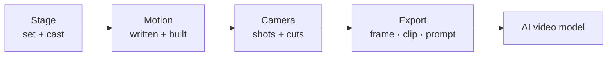

<p align="center">
  
</p>

<p align="center">
  <a href="README.md">English</a> ·
  <a href="README.ko.md">한국어</a> ·
  <a href="README.ja.md">日本語</a> ·
  <a href="README.zh-CN.md">简体中文</a> ·
  <a href="README.zh-TW.md">繁體中文</a> ·
  <b>Español</b> ·
  <a href="README.fr.md">Français</a> ·
  <a href="README.de.md">Deutsch</a> ·
  <a href="README.pt-BR.md">Português (BR)</a> ·
  <a href="README.ru.md">Русский</a>
</p>

<p align="center">
  <b>Primero la escena. Después el vídeo.</b><br>
  <em>Previs de código abierto en una pestaña del navegador: monta el set, mueve al reparto, corta la cámara y entrega el plano a un modelo de vídeo con IA.</em>
</p>

<p align="center">
  <a href="LICENSE"></a>
  <a href="https://www.npmjs.com/package/cozyclay"></a>
  
  <a href="https://github.com/HaD0Yun/CozyClay/stargazers"></a>
  <a href="https://discord.gg/Hp9V5wwgjF"></a>
</p>

<p align="center">
  <a href="https://cozyclay.org/#try">Pruébalo en el navegador</a> ·
  <a href="#inicio-rápido">Inicio rápido</a> ·
  <a href="INSTALL_FOR_AGENTS.md">Guía para agentes de IA</a> ·
  <a href="CHANGELOG.md">Cambios</a> ·
  <a href="https://discord.gg/Hp9V5wwgjF">Discord</a>
</p>

<table>
  <tr>
    <td width="50%"><video src="https://github.com/user-attachments/assets/00f28c2f-e8e2-43eb-b253-b6c2436e1818" controls muted width="100%"></video></td>
    <td width="50%"><video src="https://github.com/user-attachments/assets/4c9b1e29-4803-435c-8305-f2c899fb1c2c" controls muted width="100%"></video></td>
  </tr>
  <tr>
    <td align="center"><sub>Arriba: el greybox montado en CozyClay. Abajo: el vídeo de IA hecho a partir de él.</sub></td>
    <td align="center"><sub>La misma idea, un salto de parkour: el blocking fija el ritmo y la cámara.</sub></td>
  </tr>
</table>

## Por qué

El vídeo con IA cuesta dinero por cada toma, y un fallo significa pagar otra vez. Un prompt de texto no puede contener una escena entera: dónde está cada persona, cómo se mueve, dónde está la cámara, cuándo se corta.

CozyClay te deja tomar esas decisiones primero, en 3D, donde cambiarlas sale barato. Luego el modelo de vídeo recibe el plano como primer fotograma, un clip de referencia en greybox y un prompt que describe el encuadre real. Sigue el blocking en lugar de adivinar.



## Inicio rápido

```bash
npx cozyclay
```

Esa es toda la instalación. Necesitas Node.js 22.19 o superior y un navegador basado en Chromium. No necesitas GPU, Python ni descargar ningún modelo. El estudio se abre en `http://127.0.0.1:5180/app/`.

**Actualizar.**

- `npx cozyclay` descarga la versión más reciente cada vez que lo ejecutas.
- Tras `npm install -g cozyclay`, el estudio muestra un chip **Update** en la barra superior cuando hay una versión nueva. **Update now** la instala. **Restart now** inicia la nueva versión en el mismo terminal.
- En Windows el chip muestra el comando para copiar. La actualización con un clic está desactivada a propósito.
- `cclay update` hace lo mismo desde el terminal.
- Desactiva la comprobación para un solo arranque con `--no-update-check` o `COZYCLAY_NO_UPDATE_CHECK=1`. Desactívala para siempre con `cclay update --off` y vuelve a activarla con `cclay update --on`.

> **¿Quieres que un agente de IA lo configure?** Dale el enlace de este repositorio. Sus instrucciones están en
> [`INSTALL_FOR_AGENTS.md`](INSTALL_FOR_AGENTS.md).

## Qué puedes hacer

| | |
| --- | --- |
| **Stage** | Construye el set con primitivas y coloca luces puntuales, focos y luces direccionales. Añade personajes con rig, dibujados como figuras de cubos, o dobles de cápsula cuando nadie necesita mover una extremidad. Vuela por la vista como en un editor 3D. |
| **Move** | Describe la acción en el panel Agent. Un segundo modelo, el escritor de movimiento, escribe una especificación de movimiento, y un motor determinista crea cada fotograma y mide el deslizamiento de pies, los contactos, el equilibrio y los cuerpos dentro de objetos. El escritor lee esas cifras y hojas de contactos del resultado antes de que entre la toma. Un movimiento también puede mover objetos. Necesita haber iniciado sesión en un modelo en el panel Agent. |
| **Shoot** | Pon planos en una línea de tiempo, dibuja raíles de dolly en la Top-View, mira a través del objetivo. Gira a mano una cámara de raíl y elige a quién sigue. Cada plano conoce los límites del modelo de vídeo al que apuntas. |
| **Export** | Paquete de fotogramas clave (primer y último fotograma, clip greybox, cámara, prompt), zip de referencia para vídeo con IA (un vídeo de referencia con mosaico y desenfoque, y un prompt), mp4, pasadas de profundidad y normales, hoja de contactos, lista de cortes OTIO. |
| **Look** | El aspecto toon (sombreado plano de dos tonos con líneas negras) está activado por defecto en el visor y en cada captura y exportación. Desactívalo en **Show**, en la barra del visor. |
| **Undo anything** | Cada edición, incluido cada cambio del agente, es un paso de deshacer. |

## Dirígelo con IA

La misma escena se puede manejar desde tres sitios, en directo, mientras miras el viewport.

| Vía | Inicio | Para |
| --- | --- | --- |
| **Agent panel** | `Cmd/Ctrl+B` | Chat dentro del estudio. Inicia sesión con ChatGPT o usa tu propia clave (Anthropic, OpenAI, Gemini, MiniMax, OpenRouter, CLIProxyAPI). |
| **MCP server** | `npx -y cozyclay mcp` | Claude Desktop, Claude Code, Cursor o cualquier cliente MCP. |
| **Terminal** | `cclay live status --wait` | Agentes de código que manejan un estudio en marcha, con JSON de entrada y salida. |

```json
{ "mcpServers": { "cozyclay": { "command": "npx", "args": ["-y", "cozyclay", "mcp"] } } }
```

## Desde el código fuente

```bash
git clone https://github.com/HaD0Yun/CozyClay.git && cd CozyClay
npm install
npm run dev     # http://127.0.0.1:5180/app/
npm test
```

Las reglas de contribución están en [`AGENTS.md`](AGENTS.md). Abre los pull requests contra `main`.

## Documentación

| Lee | Para |
| --- | --- |
| [`INSTALL_FOR_AGENTS.md`](INSTALL_FOR_AGENTS.md) | Instalar, ejecutar y conectar, escrito para agentes de IA |
| [`docs/motion3-agent-guide.md`](docs/motion3-agent-guide.md) | El motor de movimiento anterior (MCP, `cclay live`, `COZYCLAY_MOTION_ENGINE=old`): especificaciones de movimiento, compilación y QA |
| [`docs/agent-cli.md`](docs/agent-cli.md) | `cclay live`, proveedores de modelos, sesiones |
| [`mcp/README.md`](mcp/README.md) | Herramientas MCP y el protocolo en vivo |
| [`docs/studio-ui-ia.md`](docs/studio-ui-ia.md) | Cada control y dónde está |
| [`docs/privacy.md`](docs/privacy.md) | Telemetría anónima y cómo desactivarla (`cclay telemetry off`) |
| [`AGENTS.md`](AGENTS.md) | Reglas de contribución |

## Guías

| Lee | Para |
| --- | --- |
| [Greybox to AI video](https://cozyclay.org/greybox-to-video/) | Por qué un bloqueo gris es la entrada más fiable para un modelo de vídeo, y el ciclo bloquear y generar |
| [Previs software compared](https://cozyclay.org/previs-software/) | Herramientas de previs gratuitas, de código abierto y en el navegador, lado a lado |
| [Seedance 2.5 camera control](https://cozyclay.org/seedance-camera-control/) | Conseguir la misma cámara en cada toma con un clip de referencia |
| [Camera control for AI video](https://cozyclay.org/ai-camera-control/) | Por qué los prompts de cámara se desvían y qué aceptan realmente los modelos |

¿Encontraste un error o quieres una función? [Abre un issue](https://github.com/HaD0Yun/CozyClay/issues).

## License

AGPL-3.0-or-later. Consulta [`LICENSE`](LICENSE), [`LICENSING.md`](LICENSING.md) y [`THIRD_PARTY_NOTICES.md`](THIRD_PARTY_NOTICES.md). Hecho por [Doyun](https://github.com/HaD0Yun) en [NomaDamas](https://github.com/NomaDamas).
