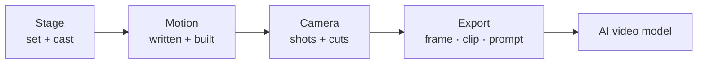

<p align="center">
  
</p>

<p align="center">
  <a href="README.md">English</a> ·
  <a href="README.ko.md">한국어</a> ·
  <a href="README.ja.md">日本語</a> ·
  <a href="README.zh-CN.md">简体中文</a> ·
  <a href="README.zh-TW.md">繁體中文</a> ·
  <a href="README.es.md">Español</a> ·
  <b>Français</b> ·
  <a href="README.de.md">Deutsch</a> ·
  <a href="README.pt-BR.md">Português (BR)</a> ·
  <a href="README.ru.md">Русский</a>
</p>

<p align="center">
  <b>D'abord la scène. Ensuite la vidéo.</b><br>
  <em>Previs open source dans un onglet de navigateur : montez le décor, animez la distribution, découpez la caméra, puis confiez le plan à un modèle vidéo IA.</em>
</p>

<p align="center">
  <a href="LICENSE"></a>
  <a href="https://www.npmjs.com/package/cozyclay"></a>
  
  <a href="https://github.com/HaD0Yun/CozyClay/stargazers"></a>
  <a href="https://discord.gg/Hp9V5wwgjF"></a>
</p>

<p align="center">
  <a href="https://cozyclay.org/#try">Essayer dans le navigateur</a> ·
  <a href="#démarrage-rapide">Démarrage rapide</a> ·
  <a href="INSTALL_FOR_AGENTS.md">Guide pour agents IA</a> ·
  <a href="CHANGELOG.md">Journal des modifications</a> ·
  <a href="https://discord.gg/Hp9V5wwgjF">Discord</a>
</p>

<table>
  <tr>
    <td width="50%"><video src="https://github.com/user-attachments/assets/00f28c2f-e8e2-43eb-b253-b6c2436e1818" controls muted width="100%"></video></td>
    <td width="50%"><video src="https://github.com/user-attachments/assets/4c9b1e29-4803-435c-8305-f2c899fb1c2c" controls muted width="100%"></video></td>
  </tr>
  <tr>
    <td align="center"><sub>En haut : le greybox monté dans CozyClay. En bas : la vidéo IA générée à partir de lui.</sub></td>
    <td align="center"><sub>Même idée, un saut de parkour : le blocking fixe le tempo et la caméra.</sub></td>
  </tr>
</table>

## Pourquoi

La vidéo IA coûte de l'argent à chaque prise, et un raté oblige à payer de nouveau. Un prompt texte ne peut pas contenir toute une scène : où se tient chacun, comment il bouge, où est la caméra, quand on coupe.

CozyClay vous laisse prendre ces décisions d'abord, en 3D, là où elles sont peu coûteuses à changer. Ensuite, le modèle vidéo reçoit le plan sous forme de première image, de clip de référence en greybox et de prompt décrivant le cadrage réel. Il suit le blocking au lieu de deviner.



## Démarrage rapide

```bash
npx cozyclay
```

C'est toute l'installation. Il faut Node.js 22.19 ou plus récent et un navigateur Chromium. Pas besoin de GPU, de Python ni de téléchargement de modèle. Le studio s'ouvre sur `http://127.0.0.1:5180/app/`.

**Mise à jour.**

- `npx cozyclay` récupère la dernière version à chaque exécution.
- Après `npm install -g cozyclay`, le studio affiche une pastille **Update** dans la barre du haut quand une nouvelle version est disponible. **Update now** l'installe. **Restart now** lance la nouvelle version dans le même terminal.
- Sous Windows, la pastille affiche la commande à copier. La mise à jour en un clic y est désactivée volontairement.
- `cclay update` fait la même chose depuis le terminal.
- Désactivez la vérification pour un seul lancement avec `--no-update-check` ou `COZYCLAY_NO_UPDATE_CHECK=1`. Désactivez-la pour de bon avec `cclay update --off`, réactivez-la avec `cclay update --on`.

> **Vous demandez à un agent IA de l'installer ?** Donnez-lui le lien de ce dépôt. Ses instructions sont dans
> [`INSTALL_FOR_AGENTS.md`](INSTALL_FOR_AGENTS.md).

## Ce que vous pouvez faire

| | |
| --- | --- |
| **Stage** | Construisez le décor avec des primitives et placez des lumières ponctuelles, des projecteurs et des lumières directionnelles. Ajoutez des personnages riggés, dessinés en figurines de cubes, ou des doublures capsules quand personne n'a besoin de bouger un membre. Survolez la vue comme dans un éditeur 3D. |
| **Move** | Décrivez l'action dans le panneau Agent. Un second modèle, le rédacteur de mouvement, écrit une spécification de mouvement, et un moteur déterministe produit chaque image et mesure le glissement des pieds, les contacts, l'équilibre et les corps entrés dans des accessoires. Le rédacteur lit ces mesures et des planches contact du résultat avant que la prise soit installée. Un mouvement peut aussi déplacer des accessoires. Il faut une connexion à un modèle dans le panneau Agent. |
| **Shoot** | Placez les plans sur une timeline, tracez des rails de travelling dans la Top-View, regardez à travers l'objectif. Tournez à la main une caméra sur rail et choisissez qui elle suit. Chaque plan connaît les limites du modèle vidéo visé. |
| **Export** | Pack d'images clés (première et dernière image, clip greybox, caméra, prompt), zip de référence pour vidéo IA (une vidéo de référence en mosaïque et flou, et un prompt), mp4, passes de profondeur et de normales, planche contact, liste de coupes OTIO. |
| **Look** | Le rendu toon (ombrage plat en deux tons avec des lignes noires) est activé par défaut dans la vue et dans chaque capture et export. Désactivez-le sous **Show** dans la barre de la vue. |
| **Undo anything** | Chaque modification, y compris chacune de celles de l'agent, est une étape d'annulation. |

## Dirigez avec l'IA

La même scène peut être pilotée depuis trois endroits, en direct, pendant que vous regardez le viewport.

| Surface | Démarrage | Pour |
| --- | --- | --- |
| **Agent panel** | `Cmd/Ctrl+B` | Chat dans le studio. Connectez-vous avec ChatGPT ou utilisez votre propre clé (Anthropic, OpenAI, Gemini, MiniMax, OpenRouter, CLIProxyAPI). |
| **MCP server** | `npx -y cozyclay mcp` | Claude Desktop, Claude Code, Cursor ou tout client MCP. |
| **Terminal** | `cclay live status --wait` | Agents de code qui pilotent un studio en cours d'exécution, JSON en entrée et en sortie. |

```json
{ "mcpServers": { "cozyclay": { "command": "npx", "args": ["-y", "cozyclay", "mcp"] } } }
```

## Depuis les sources

```bash
git clone https://github.com/HaD0Yun/CozyClay.git && cd CozyClay
npm install
npm run dev     # http://127.0.0.1:5180/app/
npm test
```

Les règles de contribution sont dans [`AGENTS.md`](AGENTS.md). Ouvrez les pull requests vers `main`.

## Documentation

| Lire | Pour |
| --- | --- |
| [`INSTALL_FOR_AGENTS.md`](INSTALL_FOR_AGENTS.md) | Installer, lancer et connecter, écrit pour les agents IA |
| [`docs/motion3-agent-guide.md`](docs/motion3-agent-guide.md) | L'ancien moteur de mouvement (MCP, `cclay live`, `COZYCLAY_MOTION_ENGINE=old`) : spécifications de mouvement, compilation et QA |
| [`docs/agent-cli.md`](docs/agent-cli.md) | `cclay live`, fournisseurs de modèles, sessions |
| [`mcp/README.md`](mcp/README.md) | Outils MCP et protocole live |
| [`docs/studio-ui-ia.md`](docs/studio-ui-ia.md) | Chaque contrôle et où il se trouve |
| [`docs/privacy.md`](docs/privacy.md) | Télémétrie anonyme et comment la désactiver (`cclay telemetry off`) |
| [`AGENTS.md`](AGENTS.md) | Règles de contribution |

## Guides

| Lire | Pour |
| --- | --- |
| [Greybox to AI video](https://cozyclay.org/greybox-to-video/) | Pourquoi un blocage gris est l'entrée la plus fiable pour un modèle vidéo, et la boucle bloquer puis générer |
| [Previs software compared](https://cozyclay.org/previs-software/) | Outils de previs gratuits, open source et dans le navigateur, côte à côte |
| [Seedance 2.5 camera control](https://cozyclay.org/seedance-camera-control/) | Obtenir la même caméra à chaque prise avec un clip de référence |
| [Camera control for AI video](https://cozyclay.org/ai-camera-control/) | Pourquoi les prompts de caméra dérivent et ce que les modèles acceptent vraiment |

Un bug ou une idée de fonctionnalité ? [Ouvrez une issue](https://github.com/HaD0Yun/CozyClay/issues).

## License

AGPL-3.0-or-later. Voir [`LICENSE`](LICENSE), [`LICENSING.md`](LICENSING.md) et [`THIRD_PARTY_NOTICES.md`](THIRD_PARTY_NOTICES.md). Créé par [Doyun](https://github.com/HaD0Yun) chez [NomaDamas](https://github.com/NomaDamas).
