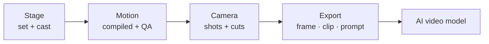

<p align="center">
  
</p>

<p align="center">
  <a href="README.md">English</a> ·
  <a href="README.ko.md">한국어</a> ·
  <b>日本語</b> ·
  <a href="README.zh-CN.md">简体中文</a> ·
  <a href="README.zh-TW.md">繁體中文</a> ·
  <a href="README.es.md">Español</a> ·
  <a href="README.fr.md">Français</a> ·
  <a href="README.de.md">Deutsch</a> ·
  <a href="README.pt-BR.md">Português (BR)</a> ·
  <a href="README.ru.md">Русский</a>
</p>

<p align="center">
  <b>まずシーンを作る。映像はそのあと。</b><br>
  <em>ブラウザのタブで使えるオープンソースのプリビズ。セットを組み、キャストを動かし、カメラを切り、そのショットを AI 動画モデルに渡します。</em>
</p>

<p align="center">
  <a href="LICENSE"></a>
  <a href="https://www.npmjs.com/package/cozyclay"></a>
  
  <a href="https://github.com/HaD0Yun/CozyClay/stargazers"></a>
  <a href="https://discord.gg/Hp9V5wwgjF"></a>
</p>

<p align="center">
  <a href="https://cozyclay.org/#try">ブラウザで試す</a> ·
  <a href="#クイックスタート">クイックスタート</a> ·
  <a href="INSTALL_FOR_AGENTS.md">AI エージェント向けガイド</a> ·
  <a href="CHANGELOG.md">変更履歴</a> ·
  <a href="https://discord.gg/Hp9V5wwgjF">Discord</a>
</p>

<table>
  <tr>
    <td width="50%"><video src="https://github.com/user-attachments/assets/00f28c2f-e8e2-43eb-b253-b6c2436e1818" controls muted width="100%"></video></td>
    <td width="50%"><video src="https://github.com/user-attachments/assets/4c9b1e29-4803-435c-8305-f2c899fb1c2c" controls muted width="100%"></video></td>
  </tr>
  <tr>
    <td align="center"><sub>上: CozyClay で組んだグレーボックス。下: それから作った AI 動画。</sub></td>
    <td align="center"><sub>同じ発想のパルクールジャンプ。ブロッキングがタイミングとカメラを保ちます。</sub></td>
  </tr>
</table>

## なぜ必要か

AI 動画は 1 テイクごとに費用がかかり、外れれば払い直しです。テキストのプロンプトだけでは、シーン全体を伝えきれません。誰がどこに立ち、どう動き、カメラはどこにあり、いつカットが変わるのかを。

CozyClay では、これらの判断を 3D の中で、変更が安いうちに先に済ませます。すると動画モデルは、最初のフレーム、グレーボックスの参照クリップ、実際の画角を説明したプロンプトとしてショットを受け取ります。推測せず、ブロッキングに従います。



## クイックスタート

```bash
npx cozyclay
```

インストールはこれだけです。Node.js 22.19 以上と Chromium 系ブラウザが必要です。GPU、Python、モデルのダウンロードは要りません。スタジオは `http://127.0.0.1:5180/app/` で開きます。

**アップデート。**

- `npx cozyclay` は実行のたびに最新リリースを取得します。
- `npm install -g cozyclay` で入れた場合、新しいリリースが出るとスタジオ上部のバーに **Update** チップが出ます。**Update now** でインストールし、**Restart now** で同じターミナルから新バージョンを起動します。
- Windows ではチップがコピー用のコマンドを表示します。ワンクリック更新は意図的にオフです。
- ターミナルからは `cclay update` で同じことができます。
- 1 回だけチェックを止めるには `--no-update-check` か `COZYCLAY_NO_UPDATE_CHECK=1`。恒久的に止めるには `cclay update --off`、戻すには `cclay update --on` です。

> **AI エージェントにセットアップを頼みますか?** このリポジトリのリンクを渡してください。手順は
> [`INSTALL_FOR_AGENTS.md`](INSTALL_FOR_AGENTS.md) にあります。

## できること

| | |
| --- | --- |
| **Stage** | プリミティブでセットを組みます。リグ付きキャラクターを置くか、手足を動かす必要がなければカプセルの代役を使います。3D エディタのように視点を飛ばせます。 |
| **Move** | 動きを言葉で説明します。エージェントがモーション仕様を書き、ブラウザ内の決定的コンパイラが全フレームを焼きます。衝突、足のスライド、リーチ、手の接触は、見る前に QA が検査します。 |
| **Shoot** | タイムラインにショットを置き、ドリーレールを引き、レンズ越しに覗きます。各ショットは対象の動画モデルの制限を把握しています。 |
| **Export** | キーフレームパック(最初と最後のフレーム、グレーボックスクリップ、カメラ、プロンプト)、mp4、深度・法線パス、コンタクトシート、OTIO カットリスト。 |
| **Storyboard** | 静止画派の方へ。Storyboard プロジェクトは、キャプション付きパネルの列、アニマティック、コンタクトシートで構成されます。 |
| **Undo anything** | エージェントによる変更を含め、すべての編集が 1 回の取り消し単位です。 |

## AI で演出する

同じシーンを 3 か所から、ビューポートを見ながらリアルタイムに操作できます。

| 方法 | 開始 | 用途 |
| --- | --- | --- |
| **Agent panel** | `Cmd/Ctrl+B` | スタジオ内のチャット。ChatGPT でサインインするか、自分のキー(Anthropic、OpenAI、Gemini、MiniMax、OpenRouter、CLIProxyAPI)を使います。 |
| **MCP server** | `npx -y cozyclay mcp` | Claude Desktop、Claude Code、Cursor など任意の MCP クライアント。 |
| **Terminal** | `cclay live status --wait` | 起動中のスタジオを操作するコーディングエージェント向け。入出力は JSON。 |

```json
{ "mcpServers": { "cozyclay": { "command": "npx", "args": ["-y", "cozyclay", "mcp"] } } }
```

## ソースから

```bash
git clone https://github.com/HaD0Yun/CozyClay.git && cd CozyClay
npm install
npm run dev     # http://127.0.0.1:5180/app/
npm test
```

貢献ルールは [`AGENTS.md`](AGENTS.md) にあります。プルリクエストは `main` に向けてください。

## ドキュメント

| 読む | 内容 |
| --- | --- |
| [`INSTALL_FOR_AGENTS.md`](INSTALL_FOR_AGENTS.md) | AI エージェント向けに書いた、インストール・起動・接続の手順 |
| [`docs/motion3-agent-guide.md`](docs/motion3-agent-guide.md) | モーション仕様、コンパイル、QA |
| [`docs/agent-cli.md`](docs/agent-cli.md) | `cclay live`、モデルプロバイダ、セッション |
| [`mcp/README.md`](mcp/README.md) | MCP ツールとライブプロトコル |
| [`docs/studio-ui-ia.md`](docs/studio-ui-ia.md) | すべてのコントロールとその場所 |
| [`docs/privacy.md`](docs/privacy.md) | 匿名テレメトリとその止め方(`cclay telemetry off`) |
| [`AGENTS.md`](AGENTS.md) | 貢献ルール |

## ガイド

| 読む | 内容 |
| --- | --- |
| [Greybox to AI video](https://cozyclay.org/greybox-to-video/) | なぜグレーの下書きが動画モデルへの最も確実な入力なのか、そして「ブロッキングしてから生成」の流れ |
| [Previs software compared](https://cozyclay.org/previs-software/) | 無料・オープンソース・ブラウザ型のプリビズツールの比較 |
| [Seedance 2.5 camera control](https://cozyclay.org/seedance-camera-control/) | 参照クリップで毎テイク同じカメラを得る方法 |
| [Camera control for AI video](https://cozyclay.org/ai-camera-control/) | カメラのプロンプトがぶれる理由と、モデルが実際に受け付けるもの |

バグを見つけた、または欲しい機能がありますか? [Issue を作成してください](https://github.com/HaD0Yun/CozyClay/issues)。

## License

AGPL-3.0-or-later。[`LICENSE`](LICENSE)、[`LICENSING.md`](LICENSING.md)、[`THIRD_PARTY_NOTICES.md`](THIRD_PARTY_NOTICES.md) を参照。作者: [Doyun](https://github.com/HaD0Yun)([NomaDamas](https://github.com/NomaDamas))。
