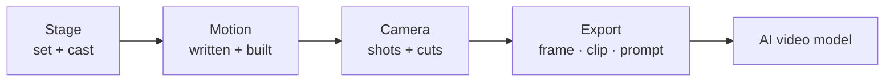

<p align="center">
  
</p>

<p align="center">
  <a href="README.md">English</a> ·
  <b>한국어</b> ·
  <a href="README.ja.md">日本語</a> ·
  <a href="README.zh-CN.md">简体中文</a> ·
  <a href="README.zh-TW.md">繁體中文</a> ·
  <a href="README.es.md">Español</a> ·
  <a href="README.fr.md">Français</a> ·
  <a href="README.de.md">Deutsch</a> ·
  <a href="README.pt-BR.md">Português (BR)</a> ·
  <a href="README.ru.md">Русский</a>
</p>

<p align="center">
  <b>먼저 장면을 만들고, 그다음에 영상으로.</b><br>
  <em>브라우저 탭에서 쓰는 오픈소스 프리비즈. 세트를 짜고, 출연진을 움직이고, 카메라를 자르고, 그 샷을 AI 영상 모델에 넘깁니다.</em>
</p>

<p align="center">
  <a href="LICENSE"></a>
  <a href="https://www.npmjs.com/package/cozyclay"></a>
  
  <a href="https://github.com/HaD0Yun/CozyClay/stargazers"></a>
  <a href="https://discord.gg/Hp9V5wwgjF"></a>
</p>

<p align="center">
  <a href="https://cozyclay.org/#try">브라우저에서 써보기</a> ·
  <a href="#빠른-시작">빠른 시작</a> ·
  <a href="INSTALL_FOR_AGENTS.md">AI 에이전트용 안내</a> ·
  <a href="CHANGELOG.md">변경 내역</a> ·
  <a href="https://discord.gg/Hp9V5wwgjF">Discord</a>
</p>

<table>
  <tr>
    <td width="50%"><video src="https://github.com/user-attachments/assets/00f28c2f-e8e2-43eb-b253-b6c2436e1818" controls muted width="100%"></video></td>
    <td width="50%"><video src="https://github.com/user-attachments/assets/4c9b1e29-4803-435c-8305-f2c899fb1c2c" controls muted width="100%"></video></td>
  </tr>
  <tr>
    <td align="center"><sub>위: CozyClay에서 짠 그레이박스. 아래: 그것으로 만든 AI 영상.</sub></td>
    <td align="center"><sub>같은 방식의 파쿠르 점프. 블로킹이 타이밍과 카메라를 그대로 붙잡아 줍니다.</sub></td>
  </tr>
</table>

## 왜 필요한가

AI 영상은 한 번 뽑을 때마다 돈이 들고, 한 번 빗나가면 다시 내야 합니다. 텍스트 프롬프트 하나로는 장면 전체를 담을 수 없습니다. 누가 어디에 서는지, 어떻게 움직이는지, 카메라가 어디 있는지, 언제 컷이 바뀌는지를요.

CozyClay에서는 이런 결정을 3D에서 먼저, 싼 값에 내립니다. 그러면 영상 모델은 첫 프레임, 그레이박스 참고 클립, 실제 화면 구성을 설명한 프롬프트로 샷을 받습니다. 추측하지 않고 블로킹을 따라갑니다.



## 빠른 시작

```bash
npx cozyclay
```

설치는 이게 전부입니다. Node.js 22.19 이상과 Chromium 계열 브라우저가 필요합니다. GPU, Python, 모델 다운로드는 필요 없습니다. 스튜디오는 `http://127.0.0.1:5180/app/`에서 열립니다.

**업데이트.**

- `npx cozyclay`는 실행할 때마다 최신 릴리스를 가져옵니다.
- `npm install -g cozyclay`로 설치했다면, 새 릴리스가 나왔을 때 스튜디오 상단 바에 **Update** 칩이 뜹니다. **Update now**가 설치하고, **Restart now**가 같은 터미널에서 새 버전을 다시 시작합니다.
- Windows에서는 칩이 복사할 명령을 보여 줍니다. 원클릭 업데이트는 의도적으로 꺼 두었습니다.
- 터미널에서는 `cclay update`가 같은 일을 합니다.
- 한 번만 확인을 끄려면 `--no-update-check` 또는 `COZYCLAY_NO_UPDATE_CHECK=1`을 씁니다. 계속 끄려면 `cclay update --off`, 다시 켜려면 `cclay update --on`입니다.

> **AI 에이전트에게 설치를 맡기시나요?** 이 저장소 링크를 건네세요. 안내는
> [`INSTALL_FOR_AGENTS.md`](INSTALL_FOR_AGENTS.md)에 있습니다.

## 할 수 있는 일

| | |
| --- | --- |
| **Stage** | 프리미티브로 세트를 짜고 점 조명, 스포트 조명, 방향 조명을 놓습니다. 큐브 인형으로 그려지는 리그 캐릭터를 넣거나, 팔다리를 움직일 필요가 없으면 캡슐 대역을 씁니다. 3D 에디터처럼 시점을 날려 다닙니다. |
| **Move** | Agent 패널에서 동작을 말로 설명합니다. 두 번째 모델인 모션 작성자가 모션 스펙을 쓰고, 결정적 엔진이 모든 프레임을 만들면서 발 미끄러짐, 접촉, 균형, 소품 안으로 들어간 몸을 잽니다. 작성자는 테이크가 들어가기 전에 그 수치와 결과의 컨택트 시트를 읽습니다. 모션은 소품도 움직일 수 있습니다. Agent 패널에서 모델에 로그인해야 합니다. |
| **Shoot** | 타임라인에 샷을 올리고, 탑뷰에서 달리 레일을 그리고, 렌즈로 들여다봅니다. 레일 카메라를 손으로 돌리고 따라갈 인물을 고릅니다. 각 샷은 목표 영상 모델의 한계를 알고 있습니다. |
| **Export** | 키프레임 팩(첫·마지막 프레임, 그레이박스 클립, 카메라, 프롬프트), AI 영상 레퍼런스 zip(모자이크와 블러를 입힌 레퍼런스 영상과 프롬프트), mp4, 깊이·노말 패스, 컨택트 시트, OTIO 컷 리스트. |
| **Look** | 툰 룩(검은 선과 2단 명암의 평평한 그림)이 뷰포트와 모든 캡처·내보내기에 기본으로 켜져 있습니다. 뷰포트 툴바의 **표시**에서 끕니다. |
| **Undo anything** | 에이전트가 한 변경을 포함해 모든 편집이 실행 취소 한 단계입니다. |

## AI로 연출하기

같은 장면을 세 곳에서, 뷰포트를 보면서 실시간으로 조종할 수 있습니다.

| 방식 | 시작 | 용도 |
| --- | --- | --- |
| **Agent panel** | `Cmd/Ctrl+B` | 스튜디오 안 채팅. ChatGPT로 로그인하거나 본인 키(Anthropic, OpenAI, Gemini, MiniMax, OpenRouter, CLIProxyAPI)를 씁니다. |
| **MCP server** | `npx -y cozyclay mcp` | Claude Desktop, Claude Code, Cursor 등 모든 MCP 클라이언트. |
| **Terminal** | `cclay live status --wait` | 실행 중인 스튜디오를 조종하는 코딩 에이전트. 입출력은 JSON. |

```json
{ "mcpServers": { "cozyclay": { "command": "npx", "args": ["-y", "cozyclay", "mcp"] } } }
```

## 소스에서 실행

```bash
git clone https://github.com/HaD0Yun/CozyClay.git && cd CozyClay
npm install
npm run dev     # http://127.0.0.1:5180/app/
npm test
```

기여 규칙은 [`AGENTS.md`](AGENTS.md)에 있습니다. 풀 리퀘스트는 `main`으로 여세요.

## 문서

| 문서 | 내용 |
| --- | --- |
| [`INSTALL_FOR_AGENTS.md`](INSTALL_FOR_AGENTS.md) | AI 에이전트를 위해 쓴 설치·실행·연결 안내 |
| [`docs/motion3-agent-guide.md`](docs/motion3-agent-guide.md) | 이전 모션 엔진(MCP, `cclay live`, `COZYCLAY_MOTION_ENGINE=old`)의 모션 스펙, 컴파일, QA |
| [`docs/agent-cli.md`](docs/agent-cli.md) | `cclay live`, 모델 제공자, 세션 |
| [`mcp/README.md`](mcp/README.md) | MCP 도구와 라이브 프로토콜 |
| [`docs/studio-ui-ia.md`](docs/studio-ui-ia.md) | 모든 컨트롤과 그 위치 |
| [`docs/privacy.md`](docs/privacy.md) | 익명 텔레메트리와 끄는 방법(`cclay telemetry off`) |
| [`AGENTS.md`](AGENTS.md) | 기여 규칙 |

## 가이드

| 문서 | 내용 |
| --- | --- |
| [Greybox to AI video](https://cozyclay.org/greybox-to-video/) | 왜 회색 블록아웃이 영상 모델에 가장 믿을 만한 입력인지, 그리고 블로킹 후 생성하는 흐름 |
| [Previs software compared](https://cozyclay.org/previs-software/) | 무료·오픈소스·브라우저 기반 프리비즈 도구 비교 |
| [Seedance 2.5 camera control](https://cozyclay.org/seedance-camera-control/) | 레퍼런스 클립으로 매 테이크 같은 카메라 얻기 |
| [Camera control for AI video](https://cozyclay.org/ai-camera-control/) | 카메라 프롬프트가 흔들리는 이유와 모델이 실제로 받아들이는 것 |

버그를 찾았거나 원하는 기능이 있나요? [이슈를 열어 주세요](https://github.com/HaD0Yun/CozyClay/issues).

## License

AGPL-3.0-or-later. [`LICENSE`](LICENSE), [`LICENSING.md`](LICENSING.md), [`THIRD_PARTY_NOTICES.md`](THIRD_PARTY_NOTICES.md)를 보세요. 만든 사람: [Doyun](https://github.com/HaD0Yun), [NomaDamas](https://github.com/NomaDamas) 소속.
