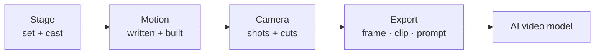

<p align="center">
  
</p>

<p align="center">
  <a href="README.md">English</a> ·
  <a href="README.ko.md">한국어</a> ·
  <a href="README.ja.md">日本語</a> ·
  <a href="README.zh-CN.md">简体中文</a> ·
  <a href="README.zh-TW.md">繁體中文</a> ·
  <a href="README.es.md">Español</a> ·
  <a href="README.fr.md">Français</a> ·
  <a href="README.de.md">Deutsch</a> ·
  <b>Português (BR)</b> ·
  <a href="README.ru.md">Русский</a>
</p>

<p align="center">
  <b>Primeiro a cena. Depois o vídeo.</b><br>
  <em>Previs de código aberto numa aba do navegador: monte o set, movimente o elenco, corte a câmera e entregue o plano a um modelo de vídeo com IA.</em>
</p>

<p align="center">
  <a href="LICENSE"></a>
  <a href="https://www.npmjs.com/package/cozyclay"></a>
  
  <a href="https://github.com/HaD0Yun/CozyClay/stargazers"></a>
  <a href="https://discord.gg/Hp9V5wwgjF"></a>
</p>

<p align="center">
  <a href="https://cozyclay.org/#try">Experimente no navegador</a> ·
  <a href="#início-rápido">Início rápido</a> ·
  <a href="INSTALL_FOR_AGENTS.md">Guia para agentes de IA</a> ·
  <a href="CHANGELOG.md">Histórico de mudanças</a> ·
  <a href="https://discord.gg/Hp9V5wwgjF">Discord</a>
</p>

<table>
  <tr>
    <td width="50%"><video src="https://github.com/user-attachments/assets/00f28c2f-e8e2-43eb-b253-b6c2436e1818" controls muted width="100%"></video></td>
    <td width="50%"><video src="https://github.com/user-attachments/assets/4c9b1e29-4803-435c-8305-f2c899fb1c2c" controls muted width="100%"></video></td>
  </tr>
  <tr>
    <td align="center"><sub>Em cima: o greybox montado no CozyClay. Embaixo: o vídeo de IA feito a partir dele.</sub></td>
    <td align="center"><sub>A mesma ideia, um salto de parkour: o blocking mantém o tempo e a câmera.</sub></td>
  </tr>
</table>

## Por quê

Vídeo com IA custa dinheiro a cada take, e um erro significa pagar de novo. Um prompt de texto não consegue conter uma cena inteira: onde cada pessoa está, como se move, onde fica a câmera, quando há corte.

O CozyClay deixa você tomar essas decisões primeiro, em 3D, onde mudá-las é barato. Depois o modelo de vídeo recebe o plano como primeiro quadro, um clipe de referência em greybox e um prompt que descreve o enquadramento real. Ele segue o blocking em vez de adivinhar.



## Início rápido

```bash
npx cozyclay
```

Essa é toda a instalação. Você precisa de Node.js 22.19 ou mais novo e de um navegador Chromium. Não precisa de GPU, Python nem de baixar um modelo. O estúdio abre em `http://127.0.0.1:5180/app/`.

**Atualizando.**

- `npx cozyclay` busca a versão mais recente a cada execução.
- Depois de `npm install -g cozyclay`, o estúdio mostra um chip **Update** na barra superior quando há uma versão nova. **Update now** a instala. **Restart now** inicia a nova versão no mesmo terminal.
- No Windows, o chip mostra o comando para copiar. A atualização com um clique fica desligada de propósito.
- `cclay update` faz o mesmo pelo terminal.
- Desligue a verificação para uma única execução com `--no-update-check` ou `COZYCLAY_NO_UPDATE_CHECK=1`. Desligue de vez com `cclay update --off` e religue com `cclay update --on`.

> **Vai pedir a um agente de IA para configurar?** Dê a ele o link deste repositório. As instruções estão em
> [`INSTALL_FOR_AGENTS.md`](INSTALL_FOR_AGENTS.md).

## O que você pode fazer

| | |
| --- | --- |
| **Stage** | Monte o set com primitivas e posicione luzes pontuais, spots e luzes direcionais. Adicione personagens com rig, desenhados como bonecos de cubos, ou dublês em cápsula quando ninguém precisa mover um membro. Voe pela vista como num editor 3D. |
| **Move** | Descreva a ação no painel Agent. Um segundo modelo, o escritor de movimento, escreve uma especificação de movimento, e um motor determinístico cria cada quadro e mede deslizamento dos pés, contatos, equilíbrio e corpos dentro de objetos. O escritor lê esses números e folhas de contatos do resultado antes de o take entrar. Um movimento também pode mover objetos. É preciso entrar com um modelo no painel Agent. |
| **Shoot** | Coloque planos numa linha do tempo, desenhe trilhos de dolly na Top-View, olhe pela lente. Gire à mão uma câmera de trilho e escolha quem ela segue. Cada plano conhece os limites do modelo de vídeo que você escolheu. |
| **Export** | Pacote de keyframes (primeiro e último quadro, clipe greybox, câmera, prompt), zip de referência para vídeo com IA (um vídeo de referência com mosaico e desfoque, e um prompt), mp4, passes de profundidade e normais, folha de contatos, lista de cortes OTIO. |
| **Look** | O visual toon (sombreamento plano em dois tons com linhas pretas) vem ligado por padrão na viewport e em toda captura e exportação. Desligue em **Show**, na barra da viewport. |
| **Undo anything** | Toda edição, inclusive cada mudança do agente, é um passo de desfazer. |

## Dirija com IA

A mesma cena pode ser conduzida de três lugares, ao vivo, enquanto você olha o viewport.

| Via | Início | Para |
| --- | --- | --- |
| **Agent panel** | `Cmd/Ctrl+B` | Chat dentro do estúdio. Entre com o ChatGPT ou use sua própria chave (Anthropic, OpenAI, Gemini, MiniMax, OpenRouter, CLIProxyAPI). |
| **MCP server** | `npx -y cozyclay mcp` | Claude Desktop, Claude Code, Cursor ou qualquer cliente MCP. |
| **Terminal** | `cclay live status --wait` | Agentes de código que conduzem um estúdio em execução, JSON de entrada e saída. |

```json
{ "mcpServers": { "cozyclay": { "command": "npx", "args": ["-y", "cozyclay", "mcp"] } } }
```

## A partir do código-fonte

```bash
git clone https://github.com/HaD0Yun/CozyClay.git && cd CozyClay
npm install
npm run dev     # http://127.0.0.1:5180/app/
npm test
```

As regras de contribuição estão em [`AGENTS.md`](AGENTS.md). Abra os pull requests para `main`.

## Documentação

| Leia | Para |
| --- | --- |
| [`INSTALL_FOR_AGENTS.md`](INSTALL_FOR_AGENTS.md) | Instalar, executar e conectar, escrito para agentes de IA |
| [`docs/motion3-agent-guide.md`](docs/motion3-agent-guide.md) | O motor de movimento antigo (MCP, `cclay live`, `COZYCLAY_MOTION_ENGINE=old`): especificações de movimento, compilação e QA |
| [`docs/agent-cli.md`](docs/agent-cli.md) | `cclay live`, provedores de modelo, sessões |
| [`mcp/README.md`](mcp/README.md) | Ferramentas MCP e o protocolo ao vivo |
| [`docs/studio-ui-ia.md`](docs/studio-ui-ia.md) | Cada controle e onde ele fica |
| [`docs/privacy.md`](docs/privacy.md) | Telemetria anônima e como desligá-la (`cclay telemetry off`) |
| [`AGENTS.md`](AGENTS.md) | Regras de contribuição |

## Guias

| Leia | Para |
| --- | --- |
| [Greybox to AI video](https://cozyclay.org/greybox-to-video/) | Por que um blockout cinza é a entrada mais confiável para um modelo de vídeo, e o ciclo de bloquear e gerar |
| [Previs software compared](https://cozyclay.org/previs-software/) | Ferramentas de previs gratuitas, de código aberto e no navegador, lado a lado |
| [Seedance 2.5 camera control](https://cozyclay.org/seedance-camera-control/) | Obter a mesma câmera em todo take com um clipe de referência |
| [Camera control for AI video](https://cozyclay.org/ai-camera-control/) | Por que os prompts de câmera desviam e o que os modelos realmente aceitam |

Achou um bug ou quer um recurso? [Abra uma issue](https://github.com/HaD0Yun/CozyClay/issues).

## License

AGPL-3.0-or-later. Veja [`LICENSE`](LICENSE), [`LICENSING.md`](LICENSING.md) e [`THIRD_PARTY_NOTICES.md`](THIRD_PARTY_NOTICES.md). Feito por [Doyun](https://github.com/HaD0Yun) na [NomaDamas](https://github.com/NomaDamas).
