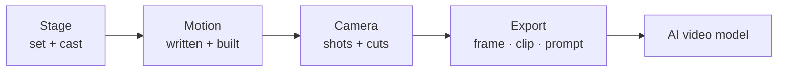

<p align="center">
  
</p>

<p align="center">
  <a href="README.md">English</a> ·
  <a href="README.ko.md">한국어</a> ·
  <a href="README.ja.md">日本語</a> ·
  <a href="README.zh-CN.md">简体中文</a> ·
  <a href="README.zh-TW.md">繁體中文</a> ·
  <a href="README.es.md">Español</a> ·
  <a href="README.fr.md">Français</a> ·
  <a href="README.de.md">Deutsch</a> ·
  <a href="README.pt-BR.md">Português (BR)</a> ·
  <b>Русский</b>
</p>

<p align="center">
  <b>Сначала сцена. Потом видео.</b><br>
  <em>Открытый previs во вкладке браузера: соберите декорации, подвигайте актёров, нарежьте камеру и отдайте кадр AI-модели для видео.</em>
</p>

<p align="center">
  <a href="LICENSE"></a>
  <a href="https://www.npmjs.com/package/cozyclay"></a>
  
  <a href="https://github.com/HaD0Yun/CozyClay/stargazers"></a>
  <a href="https://discord.gg/Hp9V5wwgjF"></a>
</p>

<p align="center">
  <a href="https://cozyclay.org/#try">Попробовать в браузере</a> ·
  <a href="#быстрый-старт">Быстрый старт</a> ·
  <a href="INSTALL_FOR_AGENTS.md">Руководство для ИИ-агентов</a> ·
  <a href="CHANGELOG.md">Список изменений</a> ·
  <a href="https://discord.gg/Hp9V5wwgjF">Discord</a>
</p>

<table>
  <tr>
    <td width="50%"><video src="https://github.com/user-attachments/assets/00f28c2f-e8e2-43eb-b253-b6c2436e1818" controls muted width="100%"></video></td>
    <td width="50%"><video src="https://github.com/user-attachments/assets/4c9b1e29-4803-435c-8305-f2c899fb1c2c" controls muted width="100%"></video></td>
  </tr>
  <tr>
    <td align="center"><sub>Сверху: грейбокс, собранный в CozyClay. Снизу: AI-видео, сделанное по нему.</sub></td>
    <td align="center"><sub>Та же идея, прыжок в паркуре: блокинг держит тайминг и камеру.</sub></td>
  </tr>
</table>

## Зачем

AI-видео стоит денег за каждый дубль, а промах значит платить снова. Текстовый промпт не вмещает целую сцену: где кто стоит, как двигается, где камера, когда монтажная склейка.

CozyClay позволяет принять эти решения заранее, в 3D, где их дёшево менять. Затем видеомодель получает кадр как первый фрейм, референс-клип в грейбоксе и промпт, описывающий реальную композицию. Она следует блокингу, а не гадает.



## Быстрый старт

```bash
npx cozyclay
```

Это вся установка. Нужны Node.js 22.19 или новее и браузер на Chromium. GPU, Python и загрузка модели не нужны. Студия открывается по адресу `http://127.0.0.1:5180/app/`.

**Обновление.**

- `npx cozyclay` при каждом запуске берёт самый свежий релиз.
- После `npm install -g cozyclay` студия показывает чип **Update** в верхней панели, когда выходит новая версия. **Update now** устанавливает её. **Restart now** запускает новую версию в том же терминале.
- В Windows чип показывает команду для копирования. Обновление в один клик там отключено намеренно.
- `cclay update` делает то же самое из терминала.
- Отключить проверку на один запуск можно через `--no-update-check` или `COZYCLAY_NO_UPDATE_CHECK=1`. Отключить насовсем: `cclay update --off`, вернуть: `cclay update --on`.

> **Поручаете установку ИИ-агенту?** Дайте ему ссылку на этот репозиторий. Инструкции лежат в
> [`INSTALL_FOR_AGENTS.md`](INSTALL_FOR_AGENTS.md).

## Что можно делать

| | |
| --- | --- |
| **Stage** | Стройте декорации из примитивов и ставьте точечные, прожекторные и направленные источники света. Добавляйте персонажей с ригом, которые рисуются кубическими фигурами, или капсулы-заместители, когда никому не нужно двигать конечностями. Летайте по виду, как в 3D-редакторе. |
| **Move** | Опишите действие в панели Agent. Вторая модель, автор движения, пишет спецификацию движения, а детерминированный движок строит каждый кадр и измеряет скольжение стоп, контакты, равновесие и тела внутри реквизита. Автор читает эти числа и контактные листы результата до того, как дубль будет установлен. Движение может перемещать и реквизит. Бег и прыжки следуют захваченному движению людей, при посадке, вставании и опускании на колени ноги двигаются по отдельности, а в сцене может быть верёвка, которую привязывают, перекидывают, держат и отпускают. Для этого нужен вход в аккаунт модели в панели Agent. |
| **Shoot** | Кладите кадры на таймлайн, рисуйте рельсы для долли в Top-View, смотрите через объектив. Поворачивайте камеру на рельсе вручную и выбирайте, за кем она следит. Каждый кадр знает ограничения целевой видеомодели. Камера кадра может смотреть прямо вниз или вверх, а каждый ключ камеры может выбрать плавность своего движения. |
| **Export** | Пакет ключевых кадров (первый и последний кадр, грейбокс-клип, камера, промпт), zip-референс для ИИ-видео (референсное видео с мозаикой и размытием и промпт), mp4, проходы глубины и нормалей, контактный лист, список склеек OTIO. |
| **Look** | Тун-стиль (плоское двухтоновое затенение с чёрными линиями) по умолчанию включён во вьюпорте и во всех снимках и экспортах. Выключается в меню **Show** на панели вьюпорта. |
| **Undo anything** | Каждая правка, включая каждое изменение агента, это один шаг отмены. |

## Режиссура с ИИ

Одну и ту же сцену можно вести из трёх мест, вживую, глядя на вьюпорт.

| Способ | Запуск | Для чего |
| --- | --- | --- |
| **Agent panel** | `Cmd/Ctrl+B` | Чат внутри студии. Войдите через ChatGPT или используйте свой ключ (Anthropic, OpenAI, Gemini, MiniMax, OpenRouter, CLIProxyAPI). |
| **MCP server** | `npx -y cozyclay mcp` | Claude Desktop, Claude Code, Cursor или любой MCP-клиент. |
| **Terminal** | `cclay live status --wait` | Кодовые агенты, управляющие запущенной студией, JSON на входе и выходе. |

```json
{ "mcpServers": { "cozyclay": { "command": "npx", "args": ["-y", "cozyclay", "mcp"] } } }
```

## Из исходников

```bash
git clone https://github.com/HaD0Yun/CozyClay.git && cd CozyClay
npm install
npm run dev     # http://127.0.0.1:5180/app/
npm test
```

Правила участия описаны в [`AGENTS.md`](AGENTS.md). Открывайте pull request в `main`.

## Документация

| Читать | О чём |
| --- | --- |
| [`INSTALL_FOR_AGENTS.md`](INSTALL_FOR_AGENTS.md) | Установка, запуск и подключение, написано для ИИ-агентов |
| [`docs/motion3-agent-guide.md`](docs/motion3-agent-guide.md) | Старый движок движения (MCP, `cclay live`, `COZYCLAY_MOTION_ENGINE=old`): спецификации движения, компиляция и QA |
| [`docs/agent-cli.md`](docs/agent-cli.md) | `cclay live`, провайдеры моделей, сессии |
| [`mcp/README.md`](mcp/README.md) | Инструменты MCP и живой протокол |
| [`docs/studio-ui-ia.md`](docs/studio-ui-ia.md) | Каждый элемент управления и где он находится |
| [`docs/privacy.md`](docs/privacy.md) | Анонимная телеметрия и как её отключить (`cclay telemetry off`) |
| [`AGENTS.md`](AGENTS.md) | Правила участия |

## Руководства

| Читать | О чём |
| --- | --- |
| [Greybox to AI video](https://cozyclay.org/greybox-to-video/) | Почему серый блокаут самый надёжный вход для видеомодели, и цикл «заблокировать, затем сгенерировать» |
| [Previs software compared](https://cozyclay.org/previs-software/) | Бесплатные, открытые и браузерные previs-инструменты в сравнении |
| [Seedance 2.5 camera control](https://cozyclay.org/seedance-camera-control/) | Одна и та же камера в каждом дубле с помощью референс-клипа |
| [Camera control for AI video](https://cozyclay.org/ai-camera-control/) | Почему промпты камеры уплывают и что модели действительно принимают |

Нашли баг или хотите функцию? [Откройте issue](https://github.com/HaD0Yun/CozyClay/issues).

## License

AGPL-3.0-or-later. См. [`LICENSE`](LICENSE), [`LICENSING.md`](LICENSING.md) и [`THIRD_PARTY_NOTICES.md`](THIRD_PARTY_NOTICES.md). Автор [Doyun](https://github.com/HaD0Yun), [NomaDamas](https://github.com/NomaDamas).
