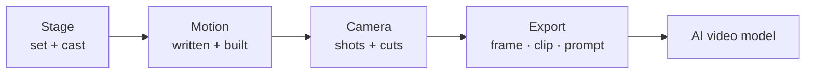

<p align="center">
  
</p>

<p align="center">
  <a href="README.md">English</a> ·
  <a href="README.ko.md">한국어</a> ·
  <a href="README.ja.md">日本語</a> ·
  <b>简体中文</b> ·
  <a href="README.zh-TW.md">繁體中文</a> ·
  <a href="README.es.md">Español</a> ·
  <a href="README.fr.md">Français</a> ·
  <a href="README.de.md">Deutsch</a> ·
  <a href="README.pt-BR.md">Português (BR)</a> ·
  <a href="README.ru.md">Русский</a>
</p>

<p align="center">
  <b>先做场景，再做视频。</b><br>
  <em>浏览器标签页里的开源预演工具:搭场景、调度角色、切镜头,再把镜头交给 AI 视频模型。</em>
</p>

<p align="center">
  <a href="LICENSE"></a>
  <a href="https://www.npmjs.com/package/cozyclay"></a>
  
  <a href="https://github.com/HaD0Yun/CozyClay/stargazers"></a>
  <a href="https://discord.gg/Hp9V5wwgjF"></a>
</p>

<p align="center">
  <a href="https://cozyclay.org/#try">在浏览器中试用</a> ·
  <a href="#快速开始">快速开始</a> ·
  <a href="INSTALL_FOR_AGENTS.md">AI 代理指南</a> ·
  <a href="CHANGELOG.md">更新日志</a> ·
  <a href="https://discord.gg/Hp9V5wwgjF">Discord</a>
</p>

<table>
  <tr>
    <td width="50%"><video src="https://github.com/user-attachments/assets/00f28c2f-e8e2-43eb-b253-b6c2436e1818" controls muted width="100%"></video></td>
    <td width="50%"><video src="https://github.com/user-attachments/assets/4c9b1e29-4803-435c-8305-f2c899fb1c2c" controls muted width="100%"></video></td>
  </tr>
  <tr>
    <td align="center"><sub>上:在 CozyClay 中搭好的灰盒。下:据此生成的 AI 视频。</sub></td>
    <td align="center"><sub>同样的思路,一个跑酷跳跃:预演锁定了节奏和镜头。</sub></td>
  </tr>
</table>

## 为什么需要它

AI 视频每出一条都要花钱,一次不中就得再付一次。单靠文字提示词,装不下整个场景:每个人站在哪、怎么动、摄影机在哪、何时切镜头。

CozyClay 让你先在 3D 里把这些决定做好,这时修改成本最低。随后视频模型拿到的是首帧、灰盒参考片段,以及描述真实构图的提示词。它会遵循预演,而不是自己猜。



## 快速开始

```bash
npx cozyclay
```

安装只需这一步。需要 Node.js 22.19 或更高版本,以及 Chromium 内核浏览器。不需要 GPU、Python,也不用下载模型。工作室会在 `http://127.0.0.1:5180/app/` 打开。

**更新。**

- `npx cozyclay` 每次运行都会获取最新版本。
- 用 `npm install -g cozyclay` 安装后,有新版本时工作室顶栏会出现 **Update** 标签。**Update now** 负责安装,**Restart now** 在同一终端启动新版本。
- 在 Windows 上,标签会显示可复制的命令。一键更新在此处被有意关闭。
- 在终端中,`cclay update` 效果相同。
- 单次启动要关闭检查,用 `--no-update-check` 或 `COZYCLAY_NO_UPDATE_CHECK=1`。永久关闭用 `cclay update --off`,重新开启用 `cclay update --on`。

> **让 AI 代理帮你安装?** 把本仓库链接给它即可。说明在
> [`INSTALL_FOR_AGENTS.md`](INSTALL_FOR_AGENTS.md)。

## 你能做什么

| | |
| --- | --- |
| **Stage** | 用基本体搭建场景,放置点光源、聚光灯和平行光。添加带骨骼的角色,画成方块人;不需要动四肢时,用胶囊体替身。像 3D 编辑器一样飞行查看。 |
| **Move** | 在 Agent 面板中描述动作。第二个模型(动作编写者)编写动作规格,确定性引擎生成每一帧,并测量脚滑、接触、平衡以及穿入道具的身体。编写者在动作片段装入之前读取这些数值和结果的联系表。动作也可以移动道具。跑步和跳跃遵循捕捉到的真人动作,坐下、起身和跪下时两条腿分别运动,场景中还可以放一根能系住、搭挂、握住和松开的绳子。需要在 Agent 面板中登录一个模型。 |
| **Shoot** | 把镜头放到时间线上,在 Top-View 中画轨道,通过镜头取景。可以手动转动轨道摄影机,并选择它跟随谁。每个镜头都清楚目标视频模型的限制。镜头摄影机可以垂直向下或向上看,每个摄影机关键帧都可以选择运动的缓动方式。 |
| **Export** | 关键帧包(首帧和末帧、灰盒片段、摄影机、提示词)、AI 视频参考 zip(马赛克加模糊的参考视频和提示词)、mp4、深度和法线通道、联系表、OTIO 剪辑列表。 |
| **Look** | 卡通外观(黑色线条加两级明暗的平面画法)在视口以及所有截图和导出中默认开启。在视口工具栏的 **Show** 中关闭。 |
| **Undo anything** | 每一次编辑,包括代理做的每个改动,都是一个撤销步骤。 |

## 用 AI 来导演

同一个场景可以从三处实时驱动,你可以边看视口边操作。

| 方式 | 启动 | 适用 |
| --- | --- | --- |
| **Agent panel** | `Cmd/Ctrl+B` | 工作室内的聊天。用 ChatGPT 登录,或使用自己的密钥(Anthropic、OpenAI、Gemini、MiniMax、OpenRouter、CLIProxyAPI)。 |
| **MCP server** | `npx -y cozyclay mcp` | Claude Desktop、Claude Code、Cursor 或任意 MCP 客户端。 |
| **Terminal** | `cclay live status --wait` | 驱动运行中工作室的编码代理,输入输出均为 JSON。 |

```json
{ "mcpServers": { "cozyclay": { "command": "npx", "args": ["-y", "cozyclay", "mcp"] } } }
```

## 从源码运行

```bash
git clone https://github.com/HaD0Yun/CozyClay.git && cd CozyClay
npm install
npm run dev     # http://127.0.0.1:5180/app/
npm test
```

贡献规则见 [`AGENTS.md`](AGENTS.md)。请向 `main` 提交拉取请求。

## 文档

| 阅读 | 内容 |
| --- | --- |
| [`INSTALL_FOR_AGENTS.md`](INSTALL_FOR_AGENTS.md) | 面向 AI 代理的安装、运行和连接说明 |
| [`docs/motion3-agent-guide.md`](docs/motion3-agent-guide.md) | 旧动作引擎(MCP、`cclay live`、`COZYCLAY_MOTION_ENGINE=old`)的动作规格、编译与 QA |
| [`docs/agent-cli.md`](docs/agent-cli.md) | `cclay live`、模型提供方、会话 |
| [`mcp/README.md`](mcp/README.md) | MCP 工具与实时协议 |
| [`docs/studio-ui-ia.md`](docs/studio-ui-ia.md) | 每个控件及其位置 |
| [`docs/privacy.md`](docs/privacy.md) | 匿名遥测及关闭方法(`cclay telemetry off`) |
| [`AGENTS.md`](AGENTS.md) | 贡献规则 |

## 指南

| 阅读 | 内容 |
| --- | --- |
| [Greybox to AI video](https://cozyclay.org/greybox-to-video/) | 为什么灰色白模是视频模型最可靠的输入,以及先预演再生成的流程 |
| [Previs software compared](https://cozyclay.org/previs-software/) | 免费、开源、基于浏览器的预演工具对比 |
| [Seedance 2.5 camera control](https://cozyclay.org/seedance-camera-control/) | 用参考片段让每次生成的镜头保持一致 |
| [Camera control for AI video](https://cozyclay.org/ai-camera-control/) | 摄影机提示词为何会漂移,以及模型实际接受什么 |

发现 bug 或想要新功能?[提交 issue](https://github.com/HaD0Yun/CozyClay/issues)。

## License

AGPL-3.0-or-later。参见 [`LICENSE`](LICENSE)、[`LICENSING.md`](LICENSING.md) 和 [`THIRD_PARTY_NOTICES.md`](THIRD_PARTY_NOTICES.md)。作者 [Doyun](https://github.com/HaD0Yun),隶属 [NomaDamas](https://github.com/NomaDamas)。
