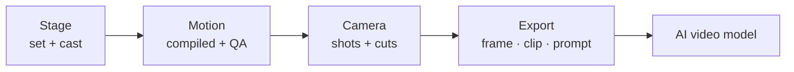

<p align="center">
  
</p>

<p align="center">
  <a href="README.md">English</a> ·
  <a href="README.ko.md">한국어</a> ·
  <a href="README.ja.md">日本語</a> ·
  <a href="README.zh-CN.md">简体中文</a> ·
  <b>繁體中文</b> ·
  <a href="README.es.md">Español</a> ·
  <a href="README.fr.md">Français</a> ·
  <a href="README.de.md">Deutsch</a> ·
  <a href="README.pt-BR.md">Português (BR)</a> ·
  <a href="README.ru.md">Русский</a>
</p>

<p align="center">
  <b>先做場景，再做影片。</b><br>
  <em>瀏覽器分頁裡的開源預演工具:搭場景、調度角色、切鏡頭,再把鏡頭交給 AI 影片模型。</em>
</p>

<p align="center">
  <a href="LICENSE"></a>
  <a href="https://www.npmjs.com/package/cozyclay"></a>
  
  <a href="https://github.com/HaD0Yun/CozyClay/stargazers"></a>
  <a href="https://discord.gg/Hp9V5wwgjF"></a>
</p>

<p align="center">
  <a href="https://cozyclay.org/#try">在瀏覽器中試用</a> ·
  <a href="#快速開始">快速開始</a> ·
  <a href="INSTALL_FOR_AGENTS.md">AI 代理指南</a> ·
  <a href="CHANGELOG.md">更新日誌</a> ·
  <a href="https://discord.gg/Hp9V5wwgjF">Discord</a>
</p>

<table>
  <tr>
    <td width="50%"><video src="https://github.com/user-attachments/assets/00f28c2f-e8e2-43eb-b253-b6c2436e1818" controls muted width="100%"></video></td>
    <td width="50%"><video src="https://github.com/user-attachments/assets/4c9b1e29-4803-435c-8305-f2c899fb1c2c" controls muted width="100%"></video></td>
  </tr>
  <tr>
    <td align="center"><sub>上:在 CozyClay 中搭好的灰盒。下:據此生成的 AI 影片。</sub></td>
    <td align="center"><sub>同樣的思路,一個跑酷跳躍:預演鎖定了節奏和鏡頭。</sub></td>
  </tr>
</table>

## 為什麼需要它

AI 影片每出一支都要花錢,一次不中就得再付一次。光靠文字提示詞,裝不下整個場景:每個人站在哪、怎麼動、攝影機在哪、何時切鏡頭。

CozyClay 讓你先在 3D 裡把這些決定做好,這時修改成本最低。接著影片模型拿到的是首幀、灰盒參考片段,以及描述真實構圖的提示詞。它會遵循預演,而不是自己猜。



## 快速開始

```bash
npx cozyclay
```

安裝只需這一步。需要 Node.js 22.19 或更新版本,以及 Chromium 核心瀏覽器。不需要 GPU、Python,也不用下載模型。工作室會在 `http://127.0.0.1:5180/app/` 開啟。

**更新。**

- `npx cozyclay` 每次執行都會取得最新版本。
- 用 `npm install -g cozyclay` 安裝後,有新版本時工作室頂列會出現 **Update** 標籤。**Update now** 負責安裝,**Restart now** 在同一個終端機啟動新版本。
- 在 Windows 上,標籤會顯示可複製的指令。一鍵更新在此處是刻意關閉的。
- 在終端機中,`cclay update` 效果相同。
- 單次啟動要關閉檢查,用 `--no-update-check` 或 `COZYCLAY_NO_UPDATE_CHECK=1`。永久關閉用 `cclay update --off`,重新開啟用 `cclay update --on`。

> **想請 AI 代理幫你安裝?** 把本儲存庫連結給它即可。說明在
> [`INSTALL_FOR_AGENTS.md`](INSTALL_FOR_AGENTS.md)。

## 你能做什麼

| | |
| --- | --- |
| **Stage** | 用基本體搭建場景。加入帶骨架的角色;不需要動四肢時,用膠囊體替身。像 3D 編輯器一樣飛行檢視。 |
| **Move** | 描述動作。代理撰寫動作規格,瀏覽器中的確定性編譯器烘焙每一幀。碰撞、腳滑、可及距離和手部接觸,會在你看到之前由 QA 檢查。 |
| **Shoot** | 把鏡頭放到時間軸上,畫軌道,透過鏡頭取景。每個鏡頭都清楚目標影片模型的限制。 |
| **Export** | 關鍵幀包(首幀和末幀、灰盒片段、攝影機、提示詞)、mp4、深度與法線通道、聯絡表、OTIO 剪輯清單。 |
| **Storyboard** | 偏好靜態畫面?Storyboard 專案由附字幕的一排畫板、動態分鏡和聯絡表組成。 |
| **Undo anything** | 每一次編輯,包括代理做的每個變更,都是一個復原步驟。 |

## 用 AI 來導演

同一個場景可以從三處即時驅動,你可以邊看視埠邊操作。

| 方式 | 啟動 | 適用 |
| --- | --- | --- |
| **Agent panel** | `Cmd/Ctrl+B` | 工作室內的聊天。用 ChatGPT 登入,或使用自己的金鑰(Anthropic、OpenAI、Gemini、MiniMax、OpenRouter、CLIProxyAPI)。 |
| **MCP server** | `npx -y cozyclay mcp` | Claude Desktop、Claude Code、Cursor 或任何 MCP 用戶端。 |
| **Terminal** | `cclay live status --wait` | 驅動執行中工作室的程式代理,輸入輸出皆為 JSON。 |

```json
{ "mcpServers": { "cozyclay": { "command": "npx", "args": ["-y", "cozyclay", "mcp"] } } }
```

## 從原始碼執行

```bash
git clone https://github.com/HaD0Yun/CozyClay.git && cd CozyClay
npm install
npm run dev     # http://127.0.0.1:5180/app/
npm test
```

貢獻規則見 [`AGENTS.md`](AGENTS.md)。請向 `main` 提交拉取請求。

## 文件

| 閱讀 | 內容 |
| --- | --- |
| [`INSTALL_FOR_AGENTS.md`](INSTALL_FOR_AGENTS.md) | 為 AI 代理撰寫的安裝、執行和連線說明 |
| [`docs/motion3-agent-guide.md`](docs/motion3-agent-guide.md) | 動作規格、編譯與 QA |
| [`docs/agent-cli.md`](docs/agent-cli.md) | `cclay live`、模型提供者、工作階段 |
| [`mcp/README.md`](mcp/README.md) | MCP 工具與即時協定 |
| [`docs/studio-ui-ia.md`](docs/studio-ui-ia.md) | 每個控制項及其位置 |
| [`docs/privacy.md`](docs/privacy.md) | 匿名遙測及關閉方式(`cclay telemetry off`) |
| [`AGENTS.md`](AGENTS.md) | 貢獻規則 |

## 指南

| 閱讀 | 內容 |
| --- | --- |
| [Greybox to AI video](https://cozyclay.org/greybox-to-video/) | 為什麼灰色白模是影片模型最可靠的輸入,以及先預演再生成的流程 |
| [Previs software compared](https://cozyclay.org/previs-software/) | 免費、開源、瀏覽器版預演工具比較 |
| [Seedance 2.5 camera control](https://cozyclay.org/seedance-camera-control/) | 用參考片段讓每次生成的鏡頭保持一致 |
| [Camera control for AI video](https://cozyclay.org/ai-camera-control/) | 攝影機提示詞為何會漂移,以及模型實際接受什麼 |

發現 bug 或想要新功能?[提交 issue](https://github.com/HaD0Yun/CozyClay/issues)。

## License

AGPL-3.0-or-later。請參閱 [`LICENSE`](LICENSE)、[`LICENSING.md`](LICENSING.md) 與 [`THIRD_PARTY_NOTICES.md`](THIRD_PARTY_NOTICES.md)。作者 [Doyun](https://github.com/HaD0Yun),隸屬 [NomaDamas](https://github.com/NomaDamas)。
